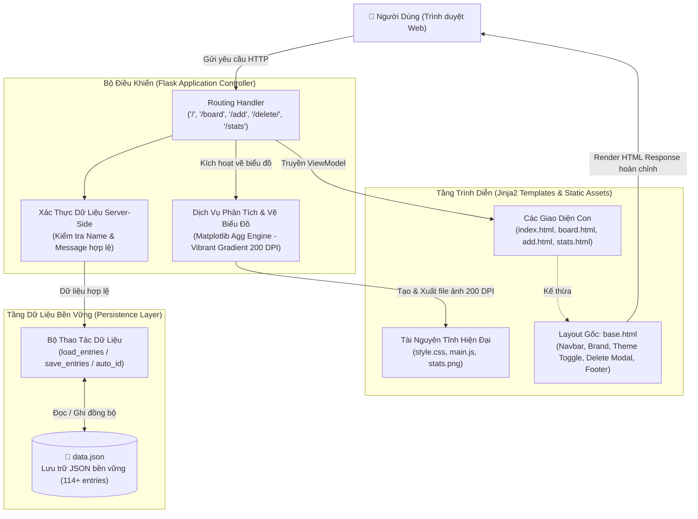
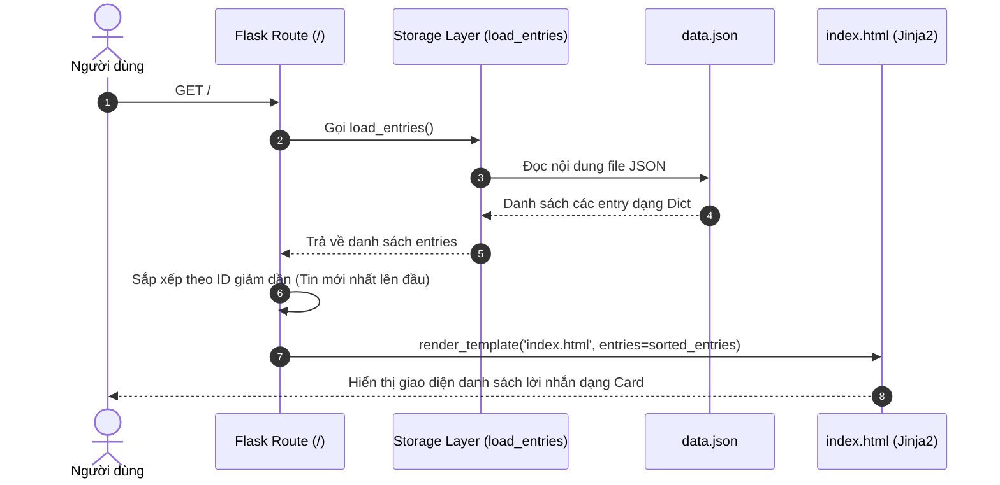
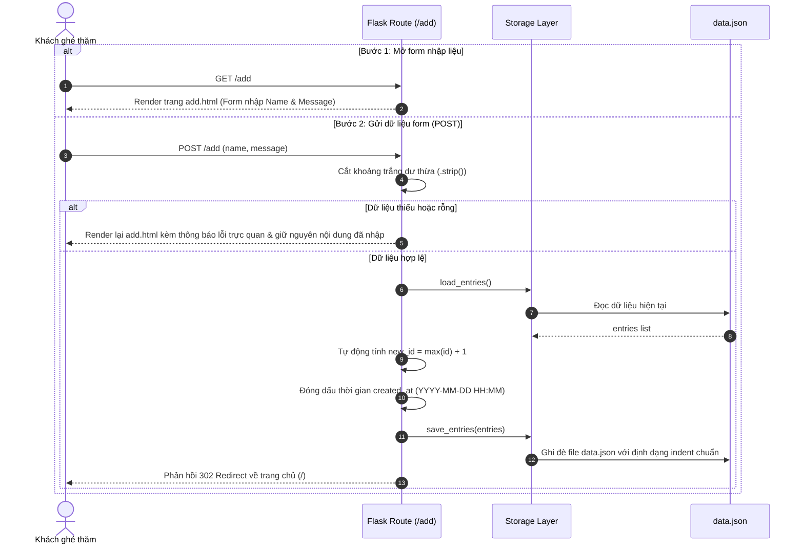
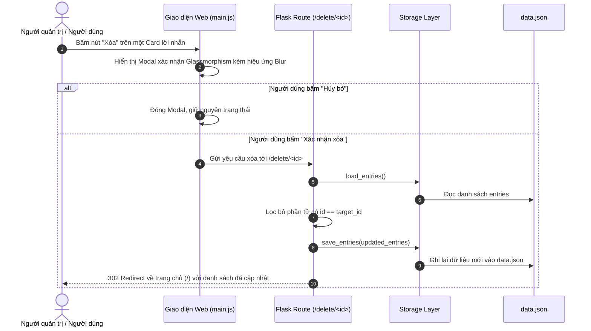
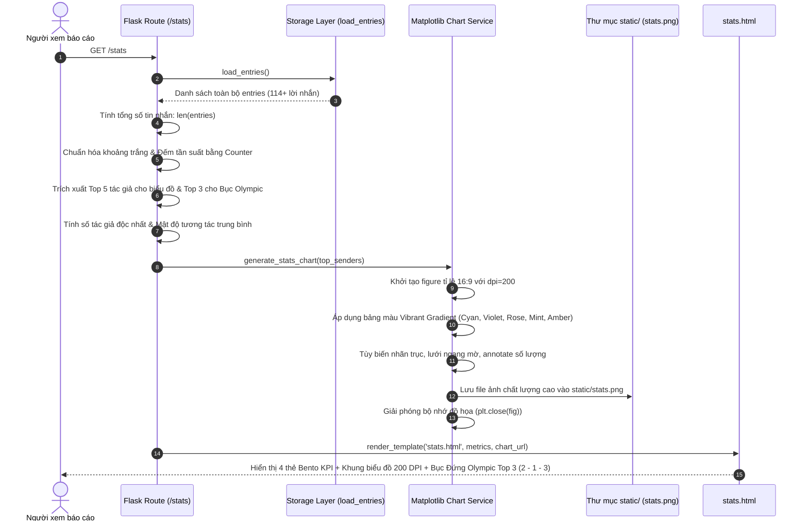
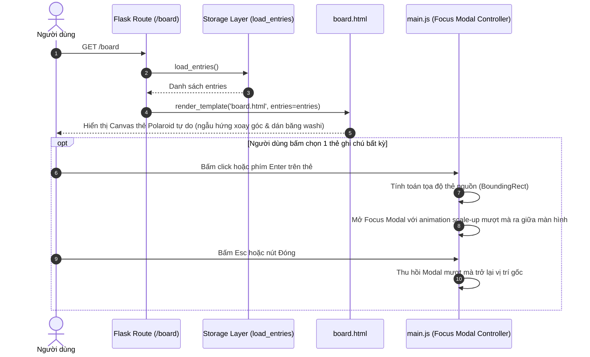

# KIẾN TRÚC HỆ THỐNG VIBE CODE GUESTBOOK (SYSTEM ARCHITECTURE)

---

## 🏗️ 1. Mô Hình Kiến Trúc Tổng Thể

Hệ thống **Vibe Code Guestbook** áp dụng kiến trúc **MVC (Model - View - Controller)** hướng module hóa, đảm bảo tính phân tách trách nhiệm (Separation of Concerns), dễ bảo trì và mở rộng:

---

## 🔄 2. Luồng Xử Lý Nghiệp Vụ Chi Tiết

### 2.1. Luồng Xem Danh Sách Lời Nhắn (`GET /`)

* **Xử lý:**
  1. Khi người dùng truy cập trang chủ, Flask kích hoạt hàm xử lý `index()`.
  2. Hệ thống đọc toàn bộ danh sách lời nhắn từ `data.json`.
  3. Sắp xếp danh sách theo ID giảm dần (`reverse=True`) để các lời nhắn mới nhất luôn hiển thị ở vị trí trên cùng.
  4. Nếu danh sách rỗng, giao diện hiển thị trạng thái Empty State trực quan kèm nút kêu gọi hành động để người dùng để lại lời nhắn đầu tiên.

---

### 2.2. Luồng Thêm Lời Nhắn Mới (`GET /add` & `POST /add`)

* **Cơ chế bảo vệ dữ liệu:**
  * **Validation Server-Side:** Không chỉ dựa vào thuộc tính `required` của HTML5, backend luôn kiểm tra `if not name or not message` để ngăn chặn các dữ liệu rỗng hoặc khoảng trắng vô nghĩa.
  * **Tự động sinh ID an toàn:** Hàm tính ID quét danh sách hiện tại để lấy giá trị lớn nhất cộng 1, đảm bảo tính duy nhất và không bị trùng lặp ngay cả khi các bản ghi trước đó đã bị xóa.

---

### 2.3. Luồng Xóa Lời Nhắn An Toàn (`POST` / `GET` `/delete/<int:id>`)

Để nâng cao trải nghiệm người dùng, phiên bản Vibe Code không sử dụng popup trình duyệt mặc định (`window.confirm`) mà tích hợp **Modal xác nhận phong cách Glassmorphism**:

---

### 2.4. Luồng Báo Cáo Thống Kê & Bục Đứng Olympic (`GET /stats`)

Ứng dụng tích hợp dịch vụ vẽ đồ thị động Matplotlib chạy ở chế độ nền (headless mode) cùng Bục đứng vinh danh Olympic Top 3:

---

### 2.5. Luồng Không Gian Trực Quan & Focus Mode (`GET /board`)

Không gian bảng ghi nhớ tự do hoài niệm đưa người dùng vào trải nghiệm lưu giữ ký ức cảm xúc:

---

## 🛡️ 3. Cơ Chế Ổn Định & Khả Năng Chịu Lỗi (Resilience)

1. **Khởi tạo dữ liệu tự thích ứng (Self-Healing Storage):**
   * Nếu file `data.json` chưa từng tồn tại, hàm `load_entries()` trả về danh sách rỗng `[]` mà không gây lỗi crash.
   * Ngay khi có lời nhắn đầu tiên được thêm, hệ thống sẽ tự động tạo mới file `data.json` với cấu trúc JSON chuẩn hóa.
2. **Quản lý tài nguyên đồ họa (No Memory Leak):**
   * Matplotlib được cấu hình sử dụng backend `matplotlib.use('Agg')` ngay từ đầu, cho phép chạy hoàn hảo trên môi trường server không có giao diện đồ họa (headless).
   * Lệnh `plt.close(fig)` được gọi lập tức sau mỗi lần xuất file `stats.png`, giải phóng 100% tài nguyên bộ nhớ đệm đồ họa.
3. **An toàn Encoding ký tự:**
   * Thao tác đọc/ghi file luôn kích hoạt `encoding='utf-8'` và `ensure_ascii=False`, bảo toàn trọn vẹn dấu tiếng Việt và các biểu tượng cảm xúc (Emoji).
