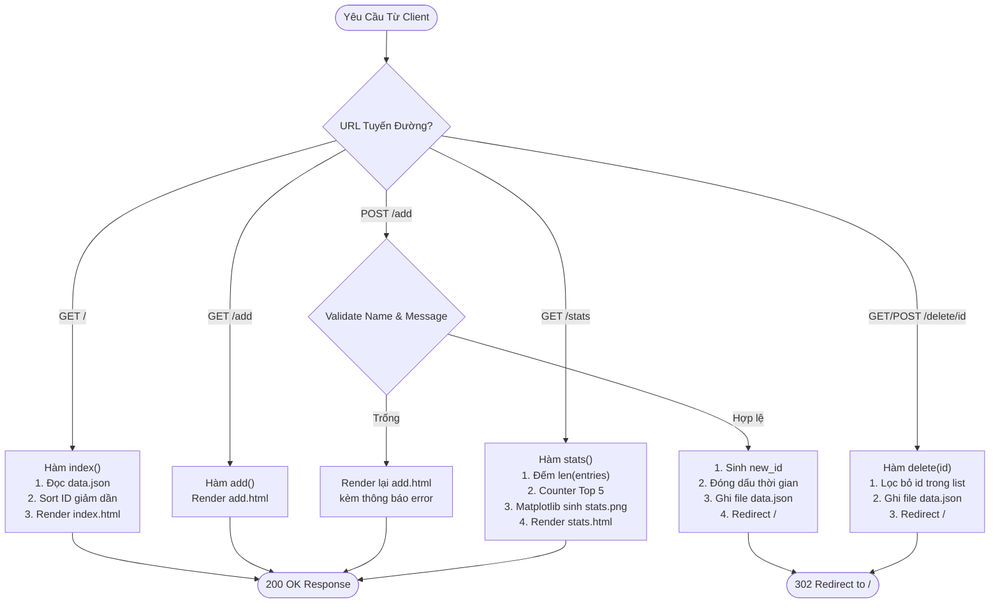

# BẢN ĐỒ TUYẾN ĐƯỜNG & ĐẶC TẢ ENDPOINTS (ROUTES MAP)

---

## 🗺️ 1. Bảng Tổng Hợp Tuyến Đường (Endpoints Map)

Hệ thống cung cấp 5 tuyến đường xử lý HTTP hoàn chỉnh cho toàn bộ vòng đời ứng dụng Sổ Lưu Bút:

| STT | Phương Thức | Tuyến Đường (Route) | Chức Năng Chính | Tham Số Đầu Vào | Kết Quả Phản Hồi (HTTP Response) |
| :---: | :---: | :--- | :--- | :--- | :--- |
| 1 | `GET` | `/` | Hiển thị toàn bộ sổ lưu bút | Không | `200 OK` - Render `index.html` (kèm danh sách `entries`) |
| 2 | `GET` | `/add` | Hiển thị form soạn lời nhắn | Không | `200 OK` - Render `add.html` |
| 3 | `POST` | `/add` | Xử lý thêm lời nhắn mới | `name`, `message` (Form Data) | `302 Found` - Redirect về `/` (thành công) hoặc `200 OK` render lại kèm `error` |
| 4 | `POST` / `GET` | `/delete/<int:id>` | Xóa một lời nhắn theo ID | `id` (Tham số URL kiểu `int`) | `302 Found` - Redirect về `/` |
| 5 | `GET` | `/stats` | Dashboard báo cáo & Biểu đồ | Không | `200 OK` - Render `stats.html` (kèm ảnh `stats.png` và các chỉ số) |

---

## 🔍 2. Đặc Tả Chi Tiết Từng Tuyến Đường

### 2.1. Tuyến Đường `GET /` - Trang Chủ Danh Sách Lời Nhắn
* **Mục đích:** Đọc dữ liệu từ cơ sở lưu trữ và trình bày danh sách thông điệp cho người dùng.
* **Quy trình xử lý tại Backend:**
  1. Gọi hàm `load_entries()` để tải danh sách các lời nhắn từ `data.json`.
  2. Áp dụng sắp xếp theo thứ tự giảm dần của `id` (`sorted(entries, key=lambda x: x.get('id', 0), reverse=True)`), đảm bảo lời nhắn gửi gần nhất luôn đứng đầu danh sách.
  3. Truyền biến `entries` vào template `index.html` để render giao diện dạng thẻ Card.
* **Mã trạng thái HTTP:** `200 OK`.

---

### 2.2. Tuyến Đường `GET /add` - Mở Form Viết Lời Nhắn
* **Mục đích:** Trả về giao diện form để khách ghé thăm nhập họ tên và thông điệp.
* **Quy trình xử lý tại Backend:**
  1. Render trực tiếp template `add.html` với trạng thái form ban đầu rỗng.
* **Mã trạng thái HTTP:** `200 OK`.

---

### 2.3. Tuyến Đường `POST /add` - Tiếp Nhận & Lưu Trữ Lời Nhắn
* **Mục đích:** Xác thực dữ liệu gửi lên từ form, sinh mã định danh và lưu trữ bền vững.
* **Dữ liệu tiếp nhận (Form Body):**
  * `name`: Chuỗi văn bản tên người gửi.
  * `message`: Chuỗi văn bản nội dung thông điệp.
* **Quy tắc xác thực (Validation Rules):**
  ```python
  name = request.form.get('name', '').strip()
  message = request.form.get('message', '').strip()

  # Ràng buộc: Cả hai trường đều không được phép để trống
  if not name or not message:
      error = "Vui lòng nhập đầy đủ cả tên và nội dung lời nhắn (không được để trống)!"
      return render_template('add.html', error=error, name=name, message=message)
  ```
* **Khi dữ liệu hợp lệ:**
  1. Tải danh sách hiện tại qua `load_entries()`.
  2. Tính toán ID mới: `new_id = max([e.get('id', 0) for e in entries], default=0) + 1`.
  3. Đóng dấu thời gian hiện tại: `created_at = datetime.now().strftime('%Y-%m-%d %H:%M')`.
  4. Đóng gói đối tượng dict mới và thêm vào danh sách:
     ```python
     new_entry = {
         'id': new_id,
         'name': name,
         'message': message,
         'created_at': created_at
     }
     entries.append(new_entry)
     ```
  5. Ghi đồng bộ xuống file bằng `save_entries(entries)`.
  6. Thực hiện chuyển hướng trình duyệt: `redirect(url_for('index'))` với mã `302 Found`.

---

### 2.4. Tuyến Đường `/delete/<int:id>` - Xóa Lời Nhắn Theo ID
* **Mục đích:** Xóa bỏ lời nhắn được chỉ định khỏi cơ sở lưu trữ.
* **Phương thức hỗ trợ:** Cả `POST` và `GET` (được bảo vệ bởi Modal xác nhận giao diện người dùng).
* **Tham số đường dẫn:** `id` là số nguyên định danh của lời nhắn.
* **Quy trình xử lý tại Backend:**
  1. Tải danh sách hiện tại: `entries = load_entries()`.
  2. Tạo danh sách mới loại trừ phần tử có ID tương ứng:
     ```python
     updated_entries = [e for e in entries if e.get('id') != id]
     ```
  3. Kiểm tra: Nếu kích thước danh sách có sự thay đổi, tiến hành ghi lại dữ liệu bằng `save_entries(updated_entries)`.
  4. Chuyển hướng người dùng về trang chủ: `redirect(url_for('index'))`.
* **Mã trạng thái HTTP:** `302 Found`.

---

### 2.5. Tuyến Đường `GET /stats` - Trung Tâm Phân Tích & Biểu Đồ
* **Mục đích:** Tổng hợp các chỉ số định lượng và tạo biểu đồ cột phân tích trực quan.
* **Quy trình xử lý tại Backend:**
  1. **Tính tổng số lời nhắn:** `total_entries = len(entries)`.
  2. **Thống kê tần suất tác giả:**
     ```python
     sender_counts = Counter(e.get('name', 'Ẩn danh').strip() for e in entries if e.get('name'))
     top_senders = sender_counts.most_common(5) # Lấy 5 người gửi nhiều nhất
     unique_authors = len(sender_counts)        # Số lượng tác giả độc nhất
     top_contributor = top_senders[0][0] if top_senders else "Chưa có"
     ```
  3. **Khởi tạo và xuất biểu đồ Matplotlib (`generate_stats_chart`):**
     * Thiết lập chế độ vẽ không giao diện màn hình `matplotlib.use('Agg')`.
     * Vẽ biểu đồ cột bo góc với dải màu Indigo sang Violet.
     * Lưu file hình ảnh vào `static/stats.png`.
     * Thu hồi tài nguyên đồ họa với `plt.close(fig)`.
  4. **Render giao diện:**
     * Trả về template `stats.html` kèm các biến chỉ số: `total_entries`, `unique_authors`, `top_contributor`, `top_senders`.
* **Mã trạng thái HTTP:** `200 OK`.

---

## 🚦 3. Sơ Đồ Điều Hướng Xử Lý Yêu Cầu (Routing Decision Flowchart)


